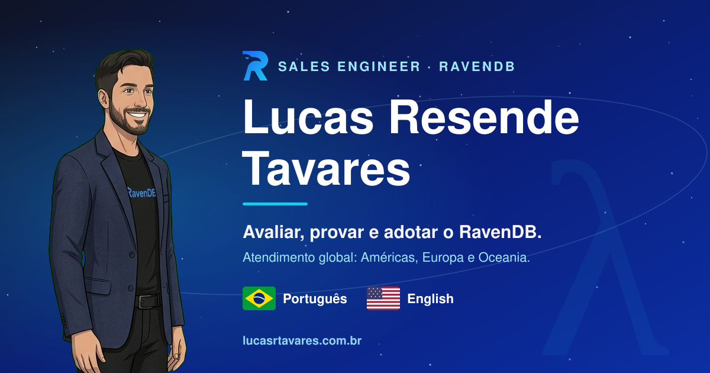
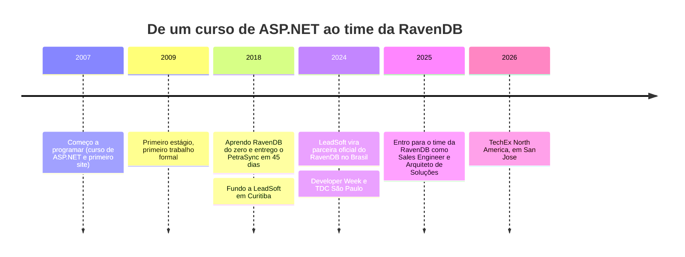

 

### Sales Engineer & Arquiteto de Soluções na [RavenDB](https://ravendb.net)
**Ajudo times do mundo todo a avaliar, provar e adotar o RavenDB**

*Primeiro o dado, depois o código.*

 

🇧🇷 Português logo abaixo · 🇺🇸 [English version](#-english)

---

## 🐦‍⬛ Oi, eu sou o Lucas

> [!IMPORTANT]
> **Em uma frase:** sou o engenheiro que, dentro da RavenDB, ajuda times a descobrir se o RavenDB resolve o problema deles, **prova isso em código** e acompanha a adoção. Atendo clientes do mundo todo, com foco nas Américas e também na Europa e na Oceania. Se não resolver, eu digo.

`.NET` · `C#` · `RavenDB` · `SQL Server` · `AWS` · `Azure` · `Google` · `TypeScript` · `React`

Sou mineiro, uai: nasci em **Belo Horizonte (MG)** 🔺 e moro em **Curitiba** desde 2015. Comecei a programar em **2007**, escrevendo no Bloco de Notas o site da empresa do meu pai, e profissionalmente em **2009**.

Em 2012, na faculdade, perguntei ao professor Gilberto por que não dava para guardar o objeto no banco do jeito que ele é, sem virar tabelas. Ainda não existia nada concreto no mercado. Em 2018, um cliente queria um sistema em 30 dias, com um banco do qual eu nunca tinha ouvido falar: o **RavenDB**. Pedi 45 dias, refiz tudo em documentos e entreguei no prazo combinado. Desde então, uso RavenDB sempre que a escolha é minha.

Em 2024, na volta de um evento em um *rooftop* em San Francisco, onde conheci o time da RavenDB, a ficha caiu dentro do Uber: *"minha nossa, o RavenDB é o banco que perguntei para o Gilberto, que uso há tantos anos, e agora cá estou…"*. Uma pergunta de sala de aula, doze anos depois, no meu caminho. Chamo isso de **efeito borboleta**, e foi o tema da minha palestra na **FAE**, *LeadSoft: o efeito borboleta no empreender*, para que estudantes prestem atenção nas sutilezas da faculdade e no que elas podem causar lá na frente.

Fundei e liderei a **[LeadSoft](https://leadsoft.inf.br)** (2018–2025), software house de Curitiba e parceira oficial do RavenDB no Brasil. Em 2025 passei para o lado de quem fabrica o banco, como **Sales Engineer e Arquiteto de Soluções**.

> [!NOTE]
> Não defendo o RavenDB porque trabalho lá. Trabalho lá porque o escolhi, em problemas reais de produção, sete anos antes de ser contratado. E quando o RavenDB não resolve, eu digo.

---

## 🧭 No que eu posso ajudar

| | |
|---|---|
| 🔍 **Avaliação e POC** | Seu caso de uso, provado em código e com benchmark contra o caminho atual |
| 🧱 **Modelagem a partir do negócio** | Documentos, índices e performance em produção: modelar pelo domínio, não pela tabela |
| 🔄 **Migração de legado** | Do relacional (ou outro NoSQL) para documentos, com **CDC e ETL**, com o sistema atual de pé |
| 🤖 **IA sobre os seus dados** | Busca textual e **vetorial**, embeddings e agentes na mesma camada de dados, sem abrir mais um produto |
| 🌎 **Atendimento global** | Foco nas Américas, e também Europa e Oceania, em português ou inglês. O seu caso chega direto à engenharia do RavenDB e, quando é comercial, ao time de vendas |

---

## 🧾 Não peça para acreditar: confira

| 🔢 | ⏱️ | ⚡ | 🧠 |
|:---:|:---:|:---:|:---:|
| **17** pacotes .NET open source | **208 mil+** downloads no NuGet | **1 sistema inteiro** em 45 dias, com RavenDB aprendido do zero | **1,8 min → 600 ms** uma consulta remodelada em RavenDB |

Nem todo ganho abaixo veio do RavenDB: parte é SQL Server bem trabalhado. Isso importa, porque quem já resolveu lentidão em banco relacional sabe separar problema de consulta de problema de banco.

| Caso | Antes → Depois | Tecnologia | Como |
|---|---|---|---|
| Consulta de recomendação técnica (DaaS, dados como serviço, setor automotivo) | **1,8 min → 600 ms** | RavenDB | Remodelagem com Full-Text Search. O tempo inclui a autenticação |
| PetraSync (cliente nos EUA) | **Sistema crítico entregue em 45 dias** | RavenDB, .NET | Sistema em más condições, prazo pedido de 30 dias. Fiz o laudo, propus 45 com a arquitetura refeita em documentos, aprendi RavenDB do zero e entreguei no dia combinado |
| Procedures críticas | **4–8 h → 40 s** | SQL Server | Reestruturação lógica com *table functions* e fim dos cursores, sem mudar a modelagem nem criar índices |
| Relatório de previsão de metas | **≈ 4 h → ≈ 30 s** | SQL Server | Nova estratégia de consulta: o relatório deixou de ficar para o dia seguinte |
| Delphi → .NET (Agrotis) | **Equipe treinada em ≈ 6 meses** | .NET, SAP | Transição de um time inteiro e integração com SAP |

---

## 🛠️ Código que você pode rodar

### 🐦 RavenDB na prática

| Repositório | O que é |
|---|---|
| [**ravendb-cdc-demo**](https://github.com/leadsoftlucas/ravendb-cdc-demo) | **IA sobre um SQL Server legado, sem migrar.** O CDC Sink do RavenDB espelha as mudanças em documentos, e em cima deles rodam busca vetorial e um agente de IA. Demonstração do meu artigo, com clínica veterinária e abrigo como domínio |
| [**ravendb-sales-assistant-demo**](https://github.com/leadsoftlucas/ravendb-sales-assistant-demo) | Assistente de vendas com os recursos de IA do RavenDB |
| [**ravendb-demo**](https://github.com/leadsoftlucas/ravendb-demo) | Três recursos do RavenDB que o diferenciam de outros bancos |
| [**lurta-clean-ravendb-api**](https://github.com/leadsoftlucas/lurta-clean-ravendb-api) | Web API REST em .NET 10 como modelo de **Clean Architecture com RavenDB** |

### 🎓 Workshops do TDC São Paulo 2024

| Repositório | O que é |
|---|---|
| [**leadsoft-tdcsp2024-ravendb-datamodel**](https://github.com/LeadSoft-Solucoes-Web/leadsoft-tdcsp2024-ravendb-datamodel) | *NoSQL: um pequeno passo na modelagem, um grande salto em eficiência* |
| [**leadsoft-tdcsp2024-getting-started-ravendb**](https://github.com/LeadSoft-Solucoes-Web/leadsoft-tdcsp2024-getting-started-ravendb) | *RavenDB: simples, ágil e eficiente* |

### 🏢 Organização [LeadSoft](https://github.com/LeadSoft-Solucoes-Web)

A maior parte do meu código aberto vive na organização da LeadSoft, a software house que fundei e liderei até 2025. São bibliotecas .NET que a LeadSoft usava nos próprios projetos e abriu para qualquer um reaproveitar:

| Repositório | O que é |
|---|---|
| [**leadsoft-global-domain**](https://github.com/LeadSoft-Solucoes-Web/leadsoft-global-domain) | Domínio global com entidades e classes úteis, para não reescrever o básico em cada projeto |
| [**leadsoft-adapter-brasilapi**](https://github.com/LeadSoft-Solucoes-Web/leadsoft-adapter-brasilapi) · [**viacep**](https://github.com/LeadSoft-Solucoes-Web/leadsoft-adapter-viacep) · [**ibge**](https://github.com/LeadSoft-Solucoes-Web/leadsoft-adapter-ibge) | Adaptadores .NET leves e testáveis para APIs públicas brasileiras, sobre `IHttpClientFactory` |
| [**leadsoft-adapter-aws**](https://github.com/LeadSoft-Solucoes-Web/leadsoft-adapter-aws) · [**azure**](https://github.com/LeadSoft-Solucoes-Web/leadsoft-adapter-azure) · [**google**](https://github.com/LeadSoft-Solucoes-Web/leadsoft-adapter-google) | Integrações com AWS (S3 e Secrets Manager), Azure (SSO, Speech-to-Text e OCR) e Google (reCAPTCHA, SSO e Workspace), em NuGets separados e prontos para injeção de dependência |
| [**leadsoft-library**](https://github.com/LeadSoft-Solucoes-Web/leadsoft-library) | O "canivete suíço" .NET: métodos de extensão, middlewares e ferramentas. Sucessor do `LeadSoft.Common.Library` |
| [**leadsoft-react-ui-kit**](https://github.com/LeadSoft-Solucoes-Web/leadsoft-react-ui-kit) | Componentes React em TypeScript (seletor de cores, animações e mais) |

<b>📦 17 pacotes .NET open source (<code>LeadSoft.*</code>) · mais de 208 mil downloads</b>

 

Bibliotecas comuns, acesso a dados e adaptadores prontos para o dia a dia de quem trabalha com .NET no Brasil e na nuvem. Os mais baixados: `Common.Library`, `Common.GlobalDomain` e `Common.DataAccess`.

| Área | Pacotes |
|---|---|
| **Base** | `LeadSoft.Common.Library` · `LeadSoft.Common.GlobalDomain` · `LeadSoft.Common.DataAccess` |
| **Brasil** | `LeadSoft.Adapter.BrasilAPI` · `LeadSoft.Adapter.ViaCep` · `LeadSoft.Adapter.IBGE` |
| **Nuvem e identidade** | `LeadSoft.Adapter.Aws.S3` · `LeadSoft.Adapter.Aws.SecretsManager` · `LeadSoft.Adapter.Azure.EntraID` · `LeadSoft.Adapter.Google.Workspace` · `LeadSoft.Adapter.Google.ReCaptcha` |
| **RavenDB e e-mail** | `LeadSoft.Adapter.RavenDBIdentity` · `LeadSoft.Adapter.Email` |

👉 [Ver todos no NuGet](https://www.nuget.org/profiles/lucastavares)

---

## ✍️ O que eu defendo por escrito

Escrevo no [LinkedIn](https://www.linkedin.com/in/lucasrtavares/recent-activity/articles/), em português, para devs e para quem decide: o custo real de dados, arquitetura e IA. Todos defendem a mesma ideia, que explico mais abaixo em [Em que eu acredito](#-em-que-eu-acredito).

| Artigo | A tese em uma linha |
|---|---|
| 🤖 [**Ninguém te disse que dá pra ter IA sem migrar seu banco de dados**](https://www.linkedin.com/pulse/ningu%C3%A9m-te-disse-que-d%C3%A1-pra-ter-ia-sem-migrar-seu-de-resende-tavares-jrzxf/) | Simulei um legado que ninguém pode desligar (SQL Server com anos de histórico) e liguei IA, busca inteligente e um agente em cima dele, ao vivo, com o CDC do RavenDB, sem tocar no que já existia. A [demonstração está aberta](https://github.com/leadsoftlucas/ravendb-cdc-demo) |
| 🔎 [**RavenDB + AI: segmentação unificada em tempo real**](https://www.linkedin.com/pulse/ravendb-ai-segmenta%C3%A7%C3%A3o-unificada-em-tempo-real-e-por-resende-tavares-r7pnf/) | Documentos, busca textual e busca vetorial na mesma consulta. Manter banco, motor de busca e vetor em três produtos custa caro |
| 📈 [**Lições de quem processa 4% do PIB**](https://www.linkedin.com/pulse/li%C3%A7%C3%B5es-de-quem-processa-4-do-pib-por-que-agilidade-%C3%A9-resende-tavares-4slnf/) | Em escala onde indisponibilidade tem preço imediato, agilidade não é discurso: é o que separa o sistema que aguenta do que trava |
| 🧩 [**Quando simplificar exige coragem: o preço oculto da complexidade**](https://www.linkedin.com/pulse/quando-simplificar-exige-coragem-o-pre%C3%A7o-oculto-das-resende-tavares-kyehf/) | Cada ferramenta a mais cobra um preço que não aparece na fatura: time refém, integrações frágeis. Simplificar é decisão técnica |
| 💻 [**Pare de usar class para tudo no C#**](https://www.linkedin.com/pulse/pare-de-usar-class-para-tudo-c-um-guia-simples-e-que-resende-tavares-tmg4f/) | Quando `class`, `struct` e `record` realmente mudam alocação, performance e o desenho da aplicação |
| 🧭 [**Por quê falo tanto sobre RavenDB**](https://www.linkedin.com/pulse/por-qu%C3%AA-falo-tanto-sobre-ravendb-lucas-resende-tavares-96yef/) | O que me fez sair do relacional por convicção, e não por modismo |

---

## 🎤 Eventos, palestras e vídeos

| Quando | Evento | Minha participação |
|---|---|---|
| 02/2024 | **Developer Week**, San Francisco 🇺🇸 | Encontro com o time RavenDB |
| 09/2024 | **TDC São Paulo** 🇧🇷 | Palestra e workshop sobre modelagem NoSQL |
| 11/2025 | **Microsoft Ignite**, San Francisco 🇺🇸 | Primeira feira como parte do time RavenDB |
| 05/2026 | **TechEx North America**, San Jose 🇺🇸 | Demonstrações ao vivo no estande da RavenDB |

🎓 Também levei a minha história para estudantes na **FAE**, com a palestra *LeadSoft: o efeito borboleta no empreender*.

- 🎥 [**NoSQL: um pequeno passo na modelagem, um grande salto em eficiência**](https://www.youtube.com/watch?v=6wBQ2GiSmv8) · TDC São Paulo 2024
- 🎥 [**The Power of RavenDB: NoSQL, Vector Database, Generative AI e AI Agents**](https://www.youtube.com/watch?v=-d7VeJ-Cqoo) · GDG Maringá
- 🎥 [**5 reasons to use RavenDB as THE database of your product**](https://www.youtube.com/watch?v=u3ePP_5KBT8) · em inglês
- 🎥 [**RavenDB Playground: teste a performance sem instalar nada**](https://www.youtube.com/watch?v=Z7dCb-jei80)

---

## 🧭 Em que eu acredito

> **Quase toda conta cara de tecnologia é conta de complexidade.**

- 🪶 **Simplificar exige coragem.** Cada ferramenta a mais tem um custo que não aparece na fatura: time refém e integrações frágeis. [Escrevi sobre isso](https://www.linkedin.com/pulse/quando-simplificar-exige-coragem-o-pre%C3%A7o-oculto-das-resende-tavares-kyehf/).
- 💼 **Software é investimento.** Ele precisa durar, e no longo prazo pesa mais a manutenção do que a lista de funções.
- 🧮 **Número antes de adjetivo.** Se não dá para medir ou conferir, não entra na conversa, como na tabela lá em cima.
- 🤝 **IA a favor, não no lugar.** Ela executa; a decisão e a responsabilidade continuam com a gente. É o que tento mostrar no [`ravendb-cdc-demo`](https://github.com/leadsoftlucas/ravendb-cdc-demo).

---

## 🛤️ A trajetória em 30 segundos

---

## 🍺 Fora do código

Escalo, faço trilhas, ouço rock e metal, escrevo ficção científica e tenho uma **Belina 1984 que virou beer truck**: a [**Choppellina**](https://choppellina.com.br) 🚐🍻. Minha música favorita é [*The Raven Child*, do Avantasia](https://open.spotify.com/intl-pt/track/76zg1a9DvGpEHVVQh7Yuv1), e sim, um corvo no meu caminho até o RavenDB é coincidência demais para ser só coincidência 🐦‍⬛. Se um dia nos encontrarmos num evento, pergunte pela Belina.

---

## 📬 Vamos conversar?

> [!TIP]
> **Quer avaliar o seu caso com RavenDB?** Me conte o problema e eu digo, com honestidade, se faz sentido. 👉 [**Fale comigo pelo site**](https://lucasrtavares.com.br/#falar)

| | |
|---|---|
| 🌐 **Site** | [lucasrtavares.com.br](https://lucasrtavares.com.br) (avaliação, POC, arquitetura e convite para palestras) |
| ✉️ **E-mail** | [lucas.tavares@ravendb.net](mailto:lucas.tavares@ravendb.net) · [eu@lucasrtavares.com.br](mailto:eu@lucasrtavares.com.br) |
| 💼 **LinkedIn** | [in/lucasrtavares](https://www.linkedin.com/in/lucasrtavares/) |
| 🎬 **YouTube** | [@LucasResendeTavares](https://www.youtube.com/@LucasResendeTavares) |
| 📦 **NuGet** | [lucastavares](https://www.nuget.org/profiles/lucastavares) |
| 📍 **Base** | Curitiba, Brasil (mineiro de Belo Horizonte 🔺) · português e inglês |

Este perfil é pessoal e **não** é um canal oficial da RavenDB.

---

<h2>🇺🇸 English</h2>

 

### 🐦‍⬛ Hi, I'm Lucas

> [!IMPORTANT]
> **In one sentence:** I'm the engineer inside RavenDB who helps teams find out whether RavenDB solves their problem, **proves it in code** and supports the adoption. I work with customers worldwide, focused on the Americas and also covering Europe and Oceania. If it doesn't fit, I'll say so.

`.NET` · `C#` · `RavenDB` · `SQL Server` · `AWS` · `Azure` · `Google` · `TypeScript` · `React`

I'm a **Sales Engineer and Solutions Architect at [RavenDB](https://ravendb.net)**, born in **Belo Horizonte, Minas Gerais** 🔺 and living in **Curitiba** since 2015. I started programming in **2007**, writing my father's company website in Notepad, and professionally in **2009**.

In 2012, in college, I asked my professor Gilberto why we couldn't store an object in the database as it is, without flattening it into tables. Nothing solid existed on the market yet. In 2018, a client wanted a system in 30 days, on a database I had never heard of: **RavenDB**. I asked for 45 days, rebuilt everything as documents and delivered on the agreed day. Since then, I use RavenDB whenever the choice is mine.

In 2024, on the way back from a *rooftop* event in San Francisco where I met the RavenDB team, it hit me in the Uber: *"oh my, RavenDB is the database I asked Gilberto about, the one I've used for so many years, and here I am now…"*. A classroom question, twelve years later, on my path. I call it the **butterfly effect**, and it was the topic of my talk at **FAE**, *LeadSoft: the butterfly effect in entrepreneurship*, so that students pay attention to the subtleties of college and what they can cause down the road.

I founded and led **[LeadSoft](https://leadsoft.inf.br)** (2018–2025), a Curitiba software house and official RavenDB partner in Brazil. In 2025 I moved to the side that builds the database.

> [!NOTE]
> I don't advocate for RavenDB because I work there. I work there because I chose it, on real production problems, seven years before they hired me. And when RavenDB isn't the answer, I'll say so.

### 🧭 How I can help

- 🔍 **Evaluation and POC**: your use case, proven in code, benchmarked against your current path
- 🧱 **Data modeling from the business**: documents, indexes and performance in production
- 🔄 **Legacy migration**: relational or other NoSQL to documents, with **CDC and ETL**, while the current system stays up
- 🤖 **AI over your data**: full-text and **vector search**, embeddings and agents in the same data layer
- 🌎 **Global coverage**: focused on the Americas, also Europe and Oceania, in Portuguese or English. Your case reaches RavenDB's engineers directly and, when it's commercial, the sales team

### 🧾 Don't take my word for it

Not every gain below came from RavenDB: part of it is well-tuned SQL Server. That matters, because someone who has fixed slowness in relational databases can tell a query problem from a database problem.

| Case | Before → After | Tech |
|---|---|---|
| Technical recommendation query (DaaS, automotive) | **1.8 min → 600 ms**: remodeled with Full-Text Search, auth included | RavenDB |
| PetraSync (US client) | **Critical system delivered in 45 days**: the system was in bad shape and the client asked for 30; I wrote the assessment, proposed 45 with the architecture rebuilt as documents, learned RavenDB from scratch and delivered on the agreed day | RavenDB, .NET |
| Critical procedures | **4–8 h → 40 s**: logical restructuring, no model change, no new indexes | SQL Server |
| Goal forecasting report | **≈ 4 h → ≈ 30 s**: new query strategy | SQL Server |
| Delphi → .NET (Agrotis) | **Whole team trained in ≈ 6 months** | .NET, SAP |

### 🛠️ Code you can run

- [**ravendb-cdc-demo**](https://github.com/leadsoftlucas/ravendb-cdc-demo): AI over a legacy SQL Server without migrating it, using RavenDB's CDC Sink, vector search and an AI agent (English README included)
- [**ravendb-sales-assistant-demo**](https://github.com/leadsoftlucas/ravendb-sales-assistant-demo): a sales assistant built with RavenDB's AI features
- [**ravendb-demo**](https://github.com/leadsoftlucas/ravendb-demo): three RavenDB features that set it apart from other databases
- [**lurta-clean-ravendb-api**](https://github.com/leadsoftlucas/lurta-clean-ravendb-api): a .NET 10 REST API as a Clean Architecture template on RavenDB
- [**TDC São Paulo 2024 workshops**](https://github.com/LeadSoft-Solucoes-Web/leadsoft-tdcsp2024-ravendb-datamodel) (data modeling and getting started)
- 🏢 [**LeadSoft organization**](https://github.com/LeadSoft-Solucoes-Web): most of my open source lives here, mainly .NET adapters for AWS, Azure, Google and Brazilian public APIs
- 📦 **17 open-source .NET packages**, **200,000+ downloads**: [NuGet profile](https://www.nuget.org/profiles/lucastavares)

### 🎤 Events, talks and videos

Developer Week (San Francisco, 2024, met the RavenDB team) · TDC São Paulo (2024, talk and workshop) · Microsoft Ignite (San Francisco, 2025) · TechEx North America (San Jose, 2026, live demos at the RavenDB booth) · FAE (talk for students: *LeadSoft: the butterfly effect in entrepreneurship*)

- 🎥 [5 reasons to use RavenDB as THE database of your product](https://www.youtube.com/watch?v=u3ePP_5KBT8) (English)
- 🎥 [The Power of RavenDB: NoSQL, Vector Database, Generative AI and AI Agents](https://www.youtube.com/watch?v=-d7VeJ-Cqoo) (Portuguese)
- 🎥 [RavenDB Playground: test performance without installing anything](https://www.youtube.com/watch?v=Z7dCb-jei80) (Portuguese)

### ✍️ What I argue in writing

Articles on [LinkedIn](https://www.linkedin.com/in/lucasrtavares/recent-activity/articles/), in Portuguese, for developers and decision makers. The thread through all of them: *almost every expensive technology bill is a complexity bill.*

- 🤖 **You can have AI without migrating your database**: AI, smart search and an agent on top of a legacy SQL Server through RavenDB CDC, without touching the original system. [Open demo](https://github.com/leadsoftlucas/ravendb-cdc-demo)
- 🔎 **RavenDB + AI, unified segmentation in real time**: documents, text and vector search in one query instead of three products
- 📈 **Lessons from processing 4% of GDP**: at scale, agility is what separates the system that holds from the one that stalls
- 🧩 **When simplifying takes courage**: the hidden price of complexity
- 💻 **Stop using class for everything in C#**: when `class`, `struct` and `record` really change allocation and performance
- 🧭 **Why I talk so much about RavenDB**: why I left relational out of conviction, not fashion

### 🍺 Off the keyboard

I climb, hike, listen to rock and metal, write science fiction and run a 1984 Belina turned beer truck: [**Choppellina**](https://choppellina.com.br). My favorite song is [*The Raven Child* by Avantasia](https://open.spotify.com/track/76zg1a9DvGpEHVVQh7Yuv1), so a raven on my way to RavenDB is too much of a coincidence to be just a coincidence 🐦‍⬛.

### 📬 Reach me

> [!TIP]
> **Want to evaluate your case with RavenDB?** Tell me the problem and I'll tell you, honestly, whether it fits. 👉 [**Get in touch through my site**](https://lucasrtavares.com.br/#falar)

🌐 [lucasrtavares.com.br](https://lucasrtavares.com.br) · ✉️ [lucas.tavares@ravendb.net](mailto:lucas.tavares@ravendb.net) · 💼 [LinkedIn](https://www.linkedin.com/in/lucasrtavares/) · 🎬 [YouTube](https://www.youtube.com/@LucasResendeTavares) · 📦 [NuGet](https://www.nuget.org/profiles/lucastavares)

This is a personal profile and **not** an official RavenDB channel.

