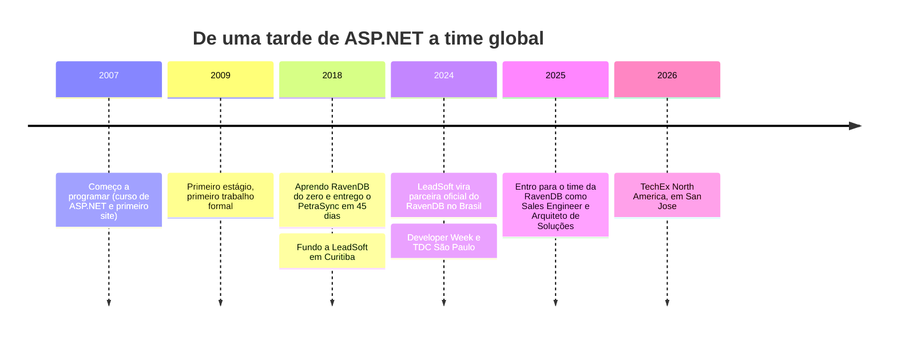

# Lucas Resende Tavares

### Sales Engineer & Arquiteto de Soluções na [RavenDB](https://ravendb.net) · a ponte do banco no Brasil 🌉

*Primeiro o dado, depois o código.*

 

🇧🇷 Português logo abaixo · 🇺🇸 [English version](#-english)

---

## 👋 Oi, eu sou o Lucas

Programo desde **2007**, profissionalmente desde **2009**, e desde **2018** só projeto software com **RavenDB**. Fundei e liderei a **LeadSoft** (2018–2025), software house de Curitiba e parceira oficial do RavenDB no Brasil. Hoje estou do outro lado do balcão: no time global do RavenDB, ajudando times a **decidir, adotar e escalar**.

> [!NOTE]
> Não defendo o RavenDB porque trabalho lá. Trabalho lá porque o escolhi durante quase uma década, em problemas reais de produção. E quando o RavenDB não resolve, eu digo.

---

## 🧭 No que eu posso ajudar

| | |
|---|---|
| 🔍 **Avaliação e POC** | Seu caso de uso, provado em código e com benchmark contra o caminho atual |
| 🧱 **Modelagem a partir do negócio** | Documentos, índices e performance em produção: modelar pelo domínio, não pela tabela |
| 🔄 **Migração de legado** | Do relacional (ou outro NoSQL) para documentos, com **CDC e ETL**, com o sistema atual de pé |
| 🤖 **IA sobre os seus dados** | Busca textual e **vetorial**, embeddings e agentes na mesma camada de dados, sem abrir mais um produto |
| 🌉 **Ponte com o time RavenDB** | Português, no seu fuso, com linha direta com a engenharia e o time comercial |

---

## 🧾 Não peça para acreditar: confira

| 🔢 | ⏱️ | ⚡ | 🧠 |
|:---:|:---:|:---:|:---:|
| **17** pacotes .NET open source | **208 mil+** downloads no NuGet | **45 dias** o cliente queria 30, eu pedi 45 e entreguei em 45 | **4 h → 30 s** um relatório que ficava para o dia seguinte |

| Caso | Antes → Depois | Como |
|---|---|---|
| Procedures críticas | **4–8 h → 40 s** | Reestruturação lógica, *table functions* e fim dos cursores. Sem mudar a modelagem nem criar índices |
| DaaS no setor automotivo | **1,8 min → 600 ms** | Recomendação remodelada em RavenDB com Full-Text Search (o tempo inclui autenticação) |
| Relatório de metas | **≈ 4 h → ≈ 30 s** | Nova estratégia de consulta |
| PetraSync (cliente nos EUA) | **30 → 45 dias, entregue em 45** | RavenDB aprendido do zero e arquitetura refeita em documentos |
| Delphi → .NET (Agrotis) | **equipe treinada em ≈ 6 meses** | Transição de um time inteiro e integração com SAP |

---

## 🛠️ Código que você pode rodar

| Repositório | O que é |
|---|---|
| [**ravendb-demo**](https://github.com/leadsoftlucas/ravendb-demo) | Demonstração prática de RavenDB |
| [**ravendb-sales-assistant-demo**](https://github.com/leadsoftlucas/ravendb-sales-assistant-demo) | Assistente de vendas com IA sobre RavenDB |
| [**leadsoft-tdcsp2024-ravendb-datamodel**](https://github.com/LeadSoft-Solucoes-Web/leadsoft-tdcsp2024-ravendb-datamodel) | Código do workshop de modelagem do TDC São Paulo 2024 |
| [**Organização LeadSoft**](https://github.com/orgs/LeadSoft-Solucoes-Web/repositories) | Os demais repositórios |

<b>📦 17 pacotes .NET open source (<code>LeadSoft.*</code>) · mais de 208 mil downloads</b>

 

Bibliotecas comuns, acesso a dados e adaptadores prontos para o dia a dia de quem trabalha com .NET no Brasil e na nuvem. Os mais baixados: `Common.Library`, `Common.GlobalDomain` e `Common.DataAccess`.

| Área | Pacotes |
|---|---|
| **Base** | `LeadSoft.Common.Library` · `LeadSoft.Common.GlobalDomain` · `LeadSoft.Common.DataAccess` |
| **Brasil** | `LeadSoft.Adapter.BrasilAPI` · `LeadSoft.Adapter.ViaCep` · `LeadSoft.Adapter.IBGE` |
| **Nuvem e identidade** | `LeadSoft.Adapter.Aws.S3` · `LeadSoft.Adapter.Aws.SecretsManager` · `LeadSoft.Adapter.Azure.EntraID` · `LeadSoft.Adapter.Google.Workspace` · `LeadSoft.Adapter.Google.ReCaptcha` |
| **RavenDB e e-mail** | `LeadSoft.Adapter.RavenDBIdentity` · `LeadSoft.Adapter.Email` |

👉 [Ver todos no NuGet](https://www.nuget.org/profiles/lucastavares)

---

## 🎤 Palcos e vídeos

| Quando | Onde | O quê |
|---|---|---|
| 02/2024 | **Developer Week**, San Francisco 🇺🇸 | Encontro com o time RavenDB |
| 09/2024 | **TDC São Paulo** 🇧🇷 | Palestra e workshop de modelagem NoSQL |
| 11/2025 | **Microsoft Ignite**, San Francisco 🇺🇸 | Primeira feira no time RavenDB |
| 05/2026 | **TechEx North America**, San Jose 🇺🇸 | Demos ao vivo no estande |

- 🎥 [**NoSQL: um pequeno passo na modelagem, um grande salto em eficiência**](https://www.youtube.com/watch?v=6wBQ2GiSmv8) · TDC São Paulo 2024
- 🎥 [**The Power of RavenDB: NoSQL, Vector Database, Generative AI e AI Agents**](https://www.youtube.com/watch?v=-d7VeJ-Cqoo) · GDG Maringá
- 🎥 [**5 reasons to use RavenDB as THE database of your product**](https://www.youtube.com/watch?v=u3ePP_5KBT8) · em inglês
- 🎥 [**RavenDB Playground: teste a performance sem instalar nada**](https://www.youtube.com/watch?v=Z7dCb-jei80)

---

## ✍️ Sobre o que eu escrevo

| Tema | Artigo |
|---|---|
| 🤖 Legado + IA | [Ninguém te disse que dá pra ter IA sem migrar seu banco de dados](https://www.linkedin.com/pulse/ningu%C3%A9m-te-disse-que-d%C3%A1-pra-ter-ia-sem-migrar-seu-de-resende-tavares-jrzxf/) |
| 🔎 RavenDB + IA | [RavenDB + AI: segmentação unificada em tempo real](https://www.linkedin.com/pulse/ravendb-ai-segmenta%C3%A7%C3%A3o-unificada-em-tempo-real-e-por-resende-tavares-r7pnf/) |
| 📈 Escala | [Lições de quem processa 4% do PIB](https://www.linkedin.com/pulse/li%C3%A7%C3%B5es-de-quem-processa-4-do-pib-por-que-agilidade-%C3%A9-resende-tavares-4slnf/) |
| 🧩 Arquitetura | [Quando simplificar exige coragem: o preço oculto da complexidade](https://www.linkedin.com/pulse/quando-simplificar-exige-coragem-o-pre%C3%A7o-oculto-das-resende-tavares-kyehf/) |
| 💻 C# na prática | [Pare de usar class para tudo no C#](https://www.linkedin.com/pulse/pare-de-usar-class-para-tudo-c-um-guia-simples-e-que-resende-tavares-tmg4f/) |
| 🧭 Manifesto | [Por quê falo tanto sobre RavenDB](https://www.linkedin.com/pulse/por-qu%C3%AA-falo-tanto-sobre-ravendb-lucas-resende-tavares-96yef/) |

---

## 🧭 Em que eu acredito

> **Quase toda conta cara de tecnologia é conta de complexidade.**

- 🪶 **Simplificar exige coragem.** Cada ferramenta a mais tem um custo que não aparece na fatura.
- 💼 **Software é investimento, não caneca.** Ele precisa durar, e a curva de manutenção importa mais que a lista de funções.
- 🧮 **Número antes de adjetivo.** Se não dá para medir ou conferir, não entra na conversa.
- 🤝 **IA a favor, não no lugar.** Ela executa; a decisão e a responsabilidade continuam com a gente.

---

## 🛤️ A trajetória em 30 segundos

---

## 🍺 Fora do código

Escalo, faço trilhas, ouço rock e metal, escrevo ficção científica e tenho uma **Belina 1984 que virou beer truck**: a [**Choppellina**](https://choppellina.com.br) 🚐🍻. Se um dia nos encontrarmos num evento, pergunte pela Belina.

---

## 📬 Vamos conversar?

| | |
|---|---|
| 🌐 **Site** | [lucasrtavares.com.br](https://lucasrtavares.com.br) (avaliação, POC, arquitetura e convite para palestras) |
| ✉️ **E-mail** | [lucas.tavares@ravendb.net](mailto:lucas.tavares@ravendb.net) · [eu@lucasrtavares.com.br](mailto:eu@lucasrtavares.com.br) |
| 💼 **LinkedIn** | [in/lucasrtavares](https://www.linkedin.com/in/lucasrtavares/) |
| 🎬 **YouTube** | [@LucasResendeTavares](https://www.youtube.com/@LucasResendeTavares) |
| 📦 **NuGet** | [lucastavares](https://www.nuget.org/profiles/lucastavares) |
| 📍 **Base** | Curitiba, Brasil · português e inglês |

Este perfil é pessoal e **não** é um canal oficial da RavenDB.

---

<h2>🇺🇸 English</h2>

 

### 👋 Hi, I'm Lucas

I'm a **Sales Engineer and Solutions Architect at [RavenDB](https://ravendb.net)** and the database's bridge to Brazil. I've been programming since **2007**, professionally since **2009**, and have designed software exclusively on **RavenDB since 2018**. I founded and led **LeadSoft** (2018–2025), a Curitiba software house and official RavenDB partner in Brazil. Today I help teams **decide, adopt and scale** on RavenDB.

> [!NOTE]
> I don't advocate for RavenDB because I work there. I work there because I chose it, for almost a decade, on real production problems. And when RavenDB isn't the answer, I'll say so.

### 🧭 How I can help

- 🔍 **Evaluation and POC**: your use case, proven in code, benchmarked against your current path
- 🧱 **Data modeling from the business**: documents, indexes and performance in production
- 🔄 **Legacy migration**: relational or other NoSQL to documents, with **CDC and ETL**, while the current system stays up
- 🤖 **AI over your data**: full-text and **vector search**, embeddings and agents in the same data layer
- 🌉 **A bridge to the RavenDB team**: Portuguese or English, in your time zone

### 🧾 Don't take my word for it

| Case | Before → After |
|---|---|
| Critical procedures | **4–8 h → 40 s** (logical restructuring, no model change, no new indexes) |
| Automotive DaaS | **1.8 min → 600 ms** (remodeled on RavenDB with Full-Text Search, auth included) |
| Goal forecasting report | **≈ 4 h → ≈ 30 s** |
| PetraSync (US client) | **They wanted 30 days. I asked for 45 and delivered in 45** |
| Delphi → .NET (Agrotis) | **Whole team trained in ≈ 6 months** |

### 🛠️ Code you can run

- [**ravendb-demo**](https://github.com/leadsoftlucas/ravendb-demo): a hands-on RavenDB demo
- [**ravendb-sales-assistant-demo**](https://github.com/leadsoftlucas/ravendb-sales-assistant-demo): an AI sales assistant on top of RavenDB
- [**TDC São Paulo 2024 data-modeling workshop**](https://github.com/LeadSoft-Solucoes-Web/leadsoft-tdcsp2024-ravendb-datamodel)
- 📦 **17 open-source .NET packages**, **200,000+ downloads**: [NuGet profile](https://www.nuget.org/profiles/lucastavares)

### 🎤 Stages and videos

Developer Week (San Francisco, 2024) · TDC São Paulo (2024) · Microsoft Ignite (San Francisco, 2025) · TechEx North America (San Jose, 2026)

- 🎥 [5 reasons to use RavenDB as THE database of your product](https://www.youtube.com/watch?v=u3ePP_5KBT8) (English)
- 🎥 [The Power of RavenDB: NoSQL, Vector Database, Generative AI and AI Agents](https://www.youtube.com/watch?v=-d7VeJ-Cqoo) (Portuguese)
- 🎥 [RavenDB Playground: test performance without installing anything](https://www.youtube.com/watch?v=Z7dCb-jei80) (Portuguese)

### ✍️ Writing

Articles on legacy + AI, vector search, scale, architecture and C#, published on [LinkedIn](https://www.linkedin.com/in/lucasrtavares/recent-activity/articles/) (in Portuguese).

### 🍺 Off the keyboard

I climb, hike, listen to rock and metal, write science fiction and run a 1984 Belina turned beer truck: [**Choppellina**](https://choppellina.com.br).

### 📬 Reach me

🌐 [lucasrtavares.com.br](https://lucasrtavares.com.br) · ✉️ [lucas.tavares@ravendb.net](mailto:lucas.tavares@ravendb.net) · 💼 [LinkedIn](https://www.linkedin.com/in/lucasrtavares/) · 🎬 [YouTube](https://www.youtube.com/@LucasResendeTavares) · 📦 [NuGet](https://www.nuget.org/profiles/lucastavares)

This is a personal profile and **not** an official RavenDB channel.

